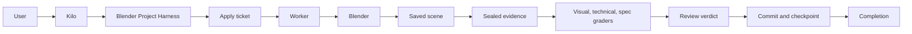

<h1 align="center">Blender Project Harness</h1>

<p align="center">
  <strong>A guarded, evidence-driven Blender production workflow for Kilo.</strong><br>
  Requirements, bounded scene changes, worker tickets, sealed evidence, independent graders, and clean project history.
</p>

<p align="center">
  <a href="https://github.com/punal100/blender-project-harness/releases"></a>
  <a href="https://www.npmjs.com/package/@punal_manalan/blender-project-harness"></a>
  <a href="https://github.com/punal100/blender-project-harness/blob/main/LICENSE"></a>
  
  
  
  <a href="https://github.com/punal100/blender-project-harness/issues"></a>
  <a href="https://github.com/punal100/blender-project-harness/pulls"></a>
</p>

<p align="center">
  <a href="#why">Why</a> |
  <a href="#features">Features</a> |
  <a href="#install">Install</a> |
  <a href="#quick-start">Quick start</a> |
  <a href="#how-it-works">How it works</a> |
  <a href="#safety-model">Safety</a> |
  <a href="#tests">Tests</a> |
  <a href="#star-history">Star history</a>
</p>

---

## Why

Blender projects are easy to start and hard to keep honest. A scene can look right in the viewport while the geometry, topology, assets, exports, and project history are wrong. A long agent session can also lose track of what changed, what was reviewed, and what is safe to commit.

Blender Project Harness makes the workflow explicit:

- requirements are confirmed before work starts;
- scene edits are bounded by object names, paths, and declared scenes;
- a worker executes one ticketed apply batch at a time;
- visual evidence is inspected, not assumed;
- the final scene, renders, facts, manifest, and evidence key are sealed;
- independent graders review frozen evidence;
- project commits and checkpoints are harness-owned;
- assets, licences, and exports are verified before completion.

The user stays in plain language. The harness handles the production contract.

---

## Features

| Area | What you get |
|---|---|
| Guarded lifecycle | Registration, `/goal-blender` missions, bounded changes, tickets, WIP renders, seals, reviews, and checkpoints |
| Single writer | One Blender instance and one apply writer at a time; parallel read-only inspection is allowed |
| Exact scope | Object names, project-relative paths, declared scenes, requirements, and milestones |
| Evidence contract | Saved scene hash, per-scene renders, camera evidence, scene facts, manifest, and evidence key |
| Geometry checks | Dimensions, transforms, materials, topology, non-manifold edges, boundary edges, and loose vertices |
| Independent grading | Visual, technical, and spec graders with primary and backup models |
| Review modes | Off, Single, and All |
| Autonomy modes | Fully Autonomous and Partially Autonomous |
| Asset governance | Intake, hashes, MIME, dimensions, source, licence, sidecars, and strict asset checks |
| Media bookkeeping | Media requests, credit records, staging, intake, retry limits, and committed failure records |
| Multi-scene support | Declared scenes, duplicate/link semantics, per-scene evidence, and a master Video Sequencer scene |
| Export receipts | Format, path, bytes, SHA-256, source scene, and signature verification |
| Kilo integration | MCP routing, plugin permissions, mission state, skills, and subagent delegation |
| Installer | Versioned install, config preservation, dependency install, and automatic backups |
| Documentation | Setup guide, expected-flow reference, project templates, and contract tests |

---

## Architecture



The harness is the only writer of workflow state. Workers execute assigned tickets. Graders read sealed evidence and write only their own reports.

---

## Install

### Requirements

| Requirement | Version / notes |
|---|---|
| Blender | 5.2 is the current tested baseline; the MCP addon requires 3.0+ |
| MCP for Blender | Pinned `mcp-for-blender==2.2.6` |
| Node.js | 22 or newer |
| npm | Bundled with Node.js |
| uv / uvx | Required for the Blender MCP addon |
| Kilo | VS Code extension or CLI |

Install the Blender addon:

```powershell
uvx --from mcp-for-blender==2.2.6 mcp-for-blender install-addon
```

Enable **Interface: MCP for Blender** under **Edit > Preferences > Add-ons**, then restart Blender.

### From npm

```powershell
npx @punal_manalan/blender-project-harness@latest install
```

The 1.0.7 package is the current release. If the registry does not have it yet, use the release
tarball or a source checkout below.

### From the release tarball

```powershell
npm install --save-dev https://github.com/punal100/blender-project-harness/releases/download/v1.0.7/punal_manalan-blender-project-harness-1.0.7.tgz
npx blender-project-harness install
```

### From source

```powershell
git clone https://github.com/punal100/blender-project-harness.git
Set-Location blender-project-harness
npm ci --prefix .kilo/blender-project-harness/tools/harness
npm run doctor --prefix .kilo/blender-project-harness/tools/harness
```

### What the installer does

- Copies the harness into `.kilo/blender-project-harness/tools/`.
- Writes `VERSION`, `install.json`, `config.json`, and a copy of the package `AGENTS.md`.
- Runs `npm ci` for the installed harness.
- Updates `.kilo/kilo.jsonc` and `.kilo/plugins/blender-workflow.js`.
- Adds missing `AGENTS.md`, `README.md`, `.kilo/skills/`, `.kilo/agent/`, and `Blender/README.md`.
- Adds the local config and backups to `.gitignore`.

Run the same command to update. The previous installation is moved to:

```text
.temp/blender-project-harness-backups/<version>-<timestamp>/
```

The old copy is preserved, not deleted. The new version keeps `config.json` unless you pass
`--reset-config`. The package `AGENTS.md` is always available at
`.kilo/blender-project-harness/AGENTS.md`. A missing root `AGENTS.md` or `README.md` is added. On
update, an existing root `AGENTS.md` or `README.md` is refreshed only when it is identical to the
previous install; locally modified files are preserved, and the replaced file is backed up under
`.temp/blender-project-harness-backups/`.

---

## Quick start

Open the workspace in Kilo and describe the project. Include the subject, style, key objects, camera
and lighting preferences, dimensions, deliverables, and whether external files or paid media
generation are allowed.

```text
Create a small cozy retro computer room. Use warm lamp light, a cool window accent, a desk with a
CRT monitor, keyboard, mug, chair, rug, and wall decor. Make one hero camera view and save the scene
inside a new Blender project.
```

The agent then:

1. Confirms requirements and asks for the workflow mode: **Fully Autonomous** or **Partially
   Autonomous**.
2. Asks for the review mode: **Off**, **Single**, or **All**.
3. Scaffolds the project, fills its records, registers it, and starts `/goal-blender`.
4. Launches Blender through the harness and saves the bootstrap scene.
5. Builds the project in bounded changes using worker apply tickets.
6. Renders and inspects WIP evidence, then seals a review round.
7. Dispatches the configured graders and aggregates their reports.
8. Commits the scoped change, checkpoints the project, and reports the result.

### `/goal-blender`

`/goal-blender` is the harness-owned mission command. It supports `start`, `status`, `pause`, `resume`,
`complete <evidence>`, and `clear`; `goal_blender` is the model-facing tool. It does not create
`kilo.goal`, and `question` stays available for clarifications and approvals. Never use the built-in
`/goal`: it invalidates the Blender registration, which then requires `/goal clear`, closing any open
change, and re-registration.

---

## How it works

```text
status and capabilities
  -> requirements confirmation
  -> workflow and review mode selection
  -> scaffold, documents, registration, and /goal-blender mission
  -> bounded scene change
  -> apply ticket and worker execution
  -> save and WIP render
  -> finalize and seal
  -> independent graders
  -> review verdict
  -> scoped commit and checkpoint
  -> completion
```

### Bounded changes

- One observable outcome per change.
- Exact object names and project-relative paths.
- Declared scenes for multi-scene work.
- Requirement and milestone scoping.
- One open change per project.
- Apply batches up to ten operations.
- Ticket expiry and change-window recovery.
- Worker-only apply execution.

### Sealed evidence

A sealed round captures:

- the saved `.blend` hash;
- per-scene renders;
- camera evidence;
- scene facts including dimensions and topology;
- a manifest with every evidence hash;
- a reproducible evidence key;
- a review round folder;
- the strict asset-check receipt when assets were used.

Graders must cite the same scene hash and evidence key. Missing evidence or tooling problems produce
`BLOCKED`, not a pass.

### Review modes

| Mode | Behavior |
|---|---|
| Off | Self-review only |
| Single | One configured grader |
| All | Every configured grader, up to `max_parallel` |

Every worker and grader has a primary and backup provider/model/reasoning variant. A missing or
disabled grader is a tooling failure, not a silent pass.

### Assets and exports

- User-supplied files enter through guarded `intake`.
- Downloads stage public HTTPS assets only; they do not import or register automatically.
- Generated media is agent-owned but harness-booked: `media-request` is required before credits are
  spent, generated files stay under `.temp`, and `intake` must link the result before commit.
- External assets require `SOURCE.md` and `LICENSE.txt`.
- Non-redistributable binaries stay out of Git.
- Strict `check_assets` must pass on the final unchanged scene.
- Exports receive a verified receipt with format, path, bytes, SHA-256, source scene, and signature.

---

## Safety model

| Guarantee | Behavior |
|---|---|
| One Blender instance | The workspace runs one guarded instance at a time |
| One writer | Apply operations execute through one worker at a time |
| Bounded edits | Every scene change has exact names, paths, and declared scenes |
| No raw Python | Arbitrary Blender Python and project Python are blocked by default; only an explicit `unsafe.sessions` development session may enable raw tools |
| No manual project Git | Project commits go through the harness |
| No silent pass | Missing evidence and grader failures produce `BLOCKED` |
| No fake assets | Generated or downloaded files must be inspected, registered, and licensed |
| No lost media | Media requests, staged paths, hashes, retries, and failures are recorded before commit |
| No hidden exports | Every export needs a verified receipt |
| No frozen-record edits | Registration changes require explicit re-registration |

---

## Configuration

Worker and grader configuration lives at:

```text
.kilo/blender-project-harness/config.json
```

The tracked template is:

```text
.kilo/blender-project-harness/config.example.json
```

Review and autonomy modes are frozen at registration. Changing them requires explicit
re-registration, not an in-place edit.

---

## Tests

```powershell
npm run test:installer
npm test --prefix .kilo/blender-project-harness/tools/harness
python -B -m unittest discover -s .kilo/blender-project-harness/tools -p "test_*.py" -v
```

The Node suite is comprehensive and can take several minutes on Windows. Use `npm run pack:check` to
inspect the npm package contents without publishing.

Current release checks:

- Installer tests: `8/8` passing.
- Plugin tests: `38/38` passing.
- Engine tests: `114/114` passing.
- Python harness contract tests: `21` passing with `113` subtests.
- Doctor: passing.
- npm package: `93` files, no `node_modules`, no local `config.json`.

---

## What's in the repo

```text
AGENTS.md                 Internal agent contract and workflow rules
README.md                 This human setup and usage guide
package.json              npm package metadata and installer entry point
bin/                      npm installer executable
installer/                Versioned installer, update, and backup logic
.kilo/                    Workspace Kilo config, skills, agents, and plugin
.kilo/blender-project-harness/
                          Harness, config, and version records
.kilo/blender-project-harness/config.example.json
                          Default worker and grader configuration
.kilo/blender-project-harness/config.json
                          Local worker and grader configuration (ignored)
.kilo/blender-project-harness/tools/harness/
                          Guarded Node.js workflow, MCP bridge, and harness tests
.kilo/blender-project-harness/tools/harness/EXPECTED_FLOW.md
                          Developer reference for the expected lifecycle and evidence
Blender/                  Blender project collection
Commands/                 Approved non-project shell-command records
```

[`Blender/README.md`](Blender/README.md) covers the project-collection conventions. The generic
harness lifecycle and evidence contract are documented in
[`.kilo/blender-project-harness/tools/harness/EXPECTED_FLOW.md`](.kilo/blender-project-harness/tools/harness/EXPECTED_FLOW.md).
Licensing lives in [`LICENSE`](LICENSE) and [`THIRD_PARTY_NOTICES.md`](THIRD_PARTY_NOTICES.md).

---

## Star history

<a href="https://www.star-history.com/#punal100/blender-project-harness&Date">
  <picture>
    <source media="(prefers-color-scheme: dark)" srcset="https://api.star-history.com/svg?repos=punal100/blender-project-harness&type=Date&theme=dark">
    <source media="(prefers-color-scheme: light)" srcset="https://api.star-history.com/svg?repos=punal100/blender-project-harness&type=Date">
    
  </picture>
</a>

Star history is provided by [star-history.com](https://www.star-history.com/).

---

## Known limits

- No arbitrary Blender Python execution.
- No browser or authentication bypass.
- No automatic licence acceptance.
- Media generation is agent-owned but harness-booked; video, audio, and model generation are not supported yet.
- Multi-scene, media-generation, and export paths are implemented, but the current live acceptance
  run is a single scene. Verify those paths in the project where they are used.
- One live Blender instance and one writer at a time; parallel read-only inspection is allowed.
- Windows is the primary documented setup environment.

---

## License

MIT. See [`LICENSE`](LICENSE).
